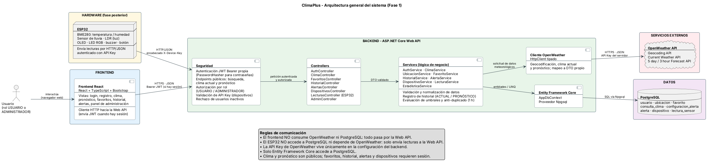

# Arquitectura

**Diagrama fuente:** [`../arquitectura/arquitectura-climaplus.puml`](../arquitectura/arquitectura-climaplus.puml)
**Imagen:** [`../arquitectura/arquitectura-climaplus.png`](../arquitectura/arquitectura-climaplus.png)
**Estado:** aprobada (D-01 a D-14)



---

## Visión general

ClimaPlus usa una arquitectura **cliente-servidor por capas**. El backend es el único punto de entrada al sistema: recibe las peticiones del navegador y del ESP32, aplica la seguridad y la lógica de negocio, y es el único que habla con OpenWeather y con PostgreSQL.

| Capa | Tecnología | Responsabilidad |
|---|---|---|
| Frontend | React + TypeScript + Bootstrap | Interfaz de usuario |
| Backend | ASP.NET Core Web API | Seguridad, controladores y lógica de negocio |
| Persistencia | Entity Framework Core + PostgreSQL 16 | Almacenamiento |
| Servicio externo | OpenWeather API | Datos meteorológicos |
| Hardware | ESP32 + sensores | Mediciones físicas (fase posterior) |

## Componentes

### Frontend

Aplicación de una sola página (SPA) construida con React, TypeScript y Bootstrap. Contiene las vistas públicas (inicio, login, registro, clima, pronóstico), las del usuario (favoritos, historial, alertas, dispositivos) y las del administrador.

Se comunica **solo** con la Web API mediante HTTPS y JSON. Cuando hay sesión iniciada, envía el JWT en el encabezado `Authorization: Bearer`. Sin sesión, solo usa las rutas públicas.

### Backend

ASP.NET Core Web API organizada en capas internas:

- **Seguridad:** autenticación JWT propia, autorización por rol, validación de la API Key de dispositivos y rechazo de usuarios o dispositivos inactivos. Define qué rutas son públicas (búsqueda, clima actual y pronóstico).
- **Controllers:** reciben la petición, validan el DTO de entrada y delegan en los servicios. Ejemplos: `AuthController`, `ClimaController`, `FavoritosController`, `HistorialController`, `AlertasController`, `DispositivosController`, `LecturasController` (ESP32) y `AdminController`.
- **Services:** contienen la lógica de negocio.

### Servicios

Los servicios (`AuthService`, `ClimaService`, `UbicacionService`, `FavoritoService`, `HistorialService`, `AlertaService`, `DispositivoService`, `LecturaService`, `EstadisticaService`) se encargan de:

- validar y normalizar los datos recibidos;
- reutilizar ubicaciones existentes por coordenadas;
- registrar el historial de consultas `ACTUAL` / `PRONOSTICO` de usuarios autenticados;
- evaluar las reglas de alerta y aplicar el anti-duplicado de 60 minutos;
- calcular las estadísticas básicas del administrador.

### Seguridad

Las decisiones de seguridad se detallan en [`07-seguridad-inicial.md`](07-seguridad-inicial.md). En resumen:

- Los usuarios se autentican con JWT. Las contraseñas se guardan como hash con `PasswordHasher`.
- El ESP32 se autentica con una API Key enviada en el encabezado `X-Device-Key`. Solo se guarda su hash SHA-256.
- La API Key de OpenWeather vive únicamente en la configuración del backend.

### Persistencia

Entity Framework Core (proveedor Npgsql) es la única vía de acceso a PostgreSQL 16. El modelo tiene 8 tablas y se describe en [`04-modelo-datos.md`](04-modelo-datos.md).

### OpenWeather

El backend tiene un cliente HTTP tipado que consume tres servicios de OpenWeather: Geocoding (búsqueda de ubicaciones), Current Weather (clima actual) y 5 day / 3 hour Forecast (pronóstico). Las respuestas se transforman a DTO propios antes de llegar al frontend, así que la interfaz no depende del formato de OpenWeather.

En una fase posterior, las rutas públicas se protegerán con Rate Limiting de ASP.NET Core y con caché temporal en `IMemoryCache` (D-14).

### Hardware

En una fase posterior, un ESP32 con BME280 (temperatura y humedad), sensor de lluvia, LDR (luz), pantalla OLED, LED RGB, buzzer y botón enviará lecturas al backend por HTTP/JSON. El ESP32 no consulta OpenWeather ni accede a la base de datos.

## Flujos principales

### 1. Consulta del usuario

```
Usuario
  → React (navegador)
    → ASP.NET Core Web API   [Seguridad → Controller]
      → Services
        → EF Core
          → PostgreSQL
```

### 2. Datos meteorológicos

```
ASP.NET Core Web API (Services → Cliente OpenWeather)
  → OpenWeather API
```

Ejemplo: un usuario autenticado consulta el clima actual de Cobán.

1. React envía la petición con el JWT.
2. El `ClimaService` pide el clima a OpenWeather mediante el cliente tipado.
3. El servicio reutiliza o registra la ubicación.
4. Guarda la consulta `ACTUAL` en `consulta_clima`.
5. Evalúa las reglas de alerta del usuario y, si corresponde, crea una alerta.
6. Devuelve un DTO a React.

Si la consulta es anónima, se omiten el registro en el historial y la evaluación de alertas.

### 3. Lecturas del ESP32

```
ESP32
  → ASP.NET Core Web API   [validación de API Key → LecturasController]
    → Services (LecturaService, AlertaService)
      → EF Core
        → PostgreSQL
```

El backend guarda la lectura, actualiza `dispositivo.ultima_conexion` y evalúa las reglas de alerta del dueño del dispositivo para la ubicación de ese dispositivo.

### Comunicaciones prohibidas

| Origen | Destino | Motivo |
|---|---|---|
| React | PostgreSQL | Expondría credenciales de la base de datos y omitiría la seguridad y las reglas de negocio |
| React | OpenWeather | Expondría la API Key de OpenWeather en el navegador |
| ESP32 | PostgreSQL | Mismas razones; además el dispositivo no debe tener credenciales de la base de datos |
| ESP32 | OpenWeather | El ESP32 solo mide su entorno; los datos meteorológicos los gestiona el backend |

## ¿Por qué el frontend y el ESP32 nunca acceden directamente a PostgreSQL?

1. **Seguridad de credenciales.** Para conectarse a PostgreSQL se necesitan un usuario y una contraseña de base de datos. Cualquier código que corre en el navegador o en el firmware de un ESP32 puede ser inspeccionado, así que esas credenciales quedarían expuestas.
2. **Control de acceso.** La base de datos no sabe qué usuario de la aplicación hace la petición. El backend verifica el JWT o la API Key, comprueba que el usuario o dispositivo esté activo y que el recurso le pertenezca.
3. **Reglas de negocio en un solo lugar.** La reutilización de ubicaciones, la evaluación de alertas, el anti-duplicado de 60 minutos y la actualización de `ultima_conexion` ocurren en los servicios. Si cada cliente escribiera directamente, esas reglas tendrían que duplicarse y podrían saltarse.
4. **Validación y normalización.** El backend valida rangos, unidades y formatos antes de guardar.
5. **Desacoplamiento.** Si cambia el esquema de la base de datos o la API meteorológica, solo cambia el backend. React y el firmware siguen usando los mismos endpoints.
