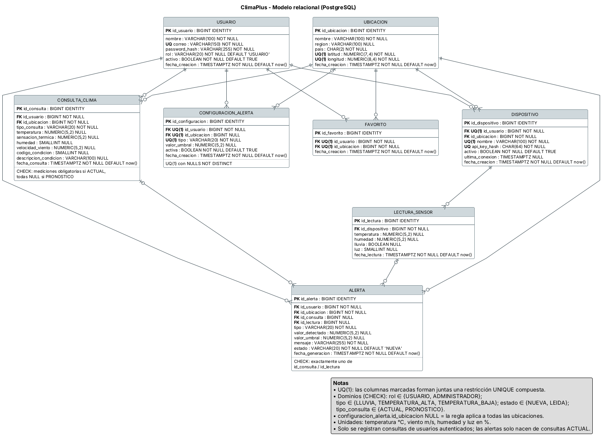

# Modelo de datos

**Diagrama fuente:** [`../base-datos/modelo-relacional.puml`](../base-datos/modelo-relacional.puml)
**Imagen:** [`../base-datos/modelo-relacional.png`](../base-datos/modelo-relacional.png)
**Detalle de campos, tipos y restricciones:** [`../base-datos/diccionario-datos.md`](../base-datos/diccionario-datos.md)
**Estado:** aprobado – Diseño de datos FASE 1 v1.0

---

## Criterios generales

- **Motor:** PostgreSQL 16 (D-05), con acceso exclusivamente mediante Entity Framework Core.
- **Identificadores:** `BIGINT GENERATED BY DEFAULT AS IDENTITY` en las 8 tablas (D-06).
- **Fechas:** `TIMESTAMPTZ` en UTC.
- **Valores de dominio:** `VARCHAR` con `CHECK` (roles, tipos de alerta, estados, tipo de consulta).
- **Borrado:** lógico para usuarios y dispositivos (`activo = FALSE`). `CASCADE` solo en datos de preferencia del usuario y `RESTRICT` en todo lo histórico.
- **Normalización:** 3FN, con tres datos guardados como fotografía del momento por decisión de diseño: `alerta.id_usuario` / `alerta.id_ubicacion`, `dispositivo.ultima_conexion` (D-12) y `alerta.mensaje` (D-13).

## Entidades

| # | Tabla | Qué representa | Puntos clave |
|---|---|---|---|
| 1 | `usuario` | Persona registrada | Correo único en minúsculas; `password_hash`; rol `USUARIO` / `ADMINISTRADOR`; `activo` para la baja lógica |
| 2 | `ubicacion` | Catálogo compartido de ubicaciones meteorológicas | No pertenece a ningún usuario; se reutiliza por `UNIQUE (latitud, longitud)` con 4 decimales (D-07); guarda nombre, región y país ISO |
| 3 | `favorito` | Ubicación guardada por un usuario | Resuelve la relación N:M usuario–ubicación; `UNIQUE (id_usuario, id_ubicacion)` |
| 4 | `configuracion_alerta` | Regla de alerta de un usuario | Tipo `LLUVIA` / `TEMPERATURA_ALTA` / `TEMPERATURA_BAJA`; sin columna `operador` (D-10); `valor_umbral` NULL solo para lluvia; `id_ubicacion` NULL = regla global; una regla por usuario + ubicación + tipo (`NULLS NOT DISTINCT`) |
| 5 | `consulta_clima` | Historial de consultas de usuarios autenticados | `tipo_consulta` `ACTUAL` / `PRONOSTICO` (D-03); `ACTUAL` guarda la fotografía meteorológica y `PRONOSTICO` solo el evento; las consultas anónimas no se guardan (D-04) |
| 6 | `dispositivo` | ESP32 registrado por un usuario | Asociado a un usuario y a una ubicación; `api_key_hash` SHA-256 único; `activo` (D-11); `ultima_conexion` (D-12) |
| 7 | `lectura_sensor` | Medición enviada por un ESP32 | Temperatura, humedad, lluvia (`BOOLEAN`) y luz 0–100 % (D-08); al menos una medición por lectura; fecha asignada por el servidor |
| 8 | `alerta` | Aviso generado para un usuario | Origen único: una consulta `ACTUAL` **o** una lectura del ESP32; guarda tipo, valor detectado, umbral vigente y `mensaje` (D-13); estado `NUEVA` / `LEIDA` |

## Relaciones y cardinalidades

| Entidad A | Relación | Entidad B | Cardinalidad | FK | ON DELETE | Motivo |
|---|---|---|---|---|---|---|
| usuario | guarda | favorito | 1 : N | favorito.id_usuario | CASCADE | Preferencia personal sin valor sin su dueño |
| ubicacion | es guardada en | favorito | 1 : N | favorito.id_ubicacion | RESTRICT | Evita perder favoritos sin aviso |
| usuario | define | configuracion_alerta | 1 : N | configuracion_alerta.id_usuario | CASCADE | Preferencia; las alertas conservan su propia copia de los datos |
| ubicacion | es objetivo de | configuracion_alerta | 0..1 : N | configuracion_alerta.id_ubicacion (NULL) | RESTRICT | `SET NULL` convertiría la regla en global sin que el usuario lo decida |
| usuario | realiza | consulta_clima | 1 : N | consulta_clima.id_usuario | RESTRICT | Historial y estadísticas |
| ubicacion | es consultada en | consulta_clima | 1 : N | consulta_clima.id_ubicacion | RESTRICT | Historial |
| usuario | posee | dispositivo | 1 : N | dispositivo.id_usuario | RESTRICT | Primero se desactiva el dispositivo |
| ubicacion | aloja | dispositivo | 1 : N | dispositivo.id_ubicacion | RESTRICT | Todo dispositivo necesita ubicación |
| dispositivo | produce | lectura_sensor | 1 : N | lectura_sensor.id_dispositivo | RESTRICT | Las lecturas son historial |
| usuario | recibe | alerta | 1 : N | alerta.id_usuario | RESTRICT | Historial de alertas |
| ubicacion | localiza | alerta | 1 : N | alerta.id_ubicacion | RESTRICT | Historial |
| consulta_clima | origina | alerta | 0..1 : N | alerta.id_consulta (NULL) | RESTRICT | `SET NULL` violaría el CHECK de origen único |
| lectura_sensor | origina | alerta | 0..1 : N | alerta.id_lectura (NULL) | RESTRICT | Mismo motivo |

**Relación N:M:** `usuario` ↔ `ubicacion`, resuelta por `favorito`.

**Origen de una alerta:** `CHECK (num_nonnulls(id_consulta, id_lectura) = 1)`. Una sola consulta o lectura puede generar varias alertas (por ejemplo, calor y lluvia a la vez).

## Índices

| Índice | Estado | Uso |
|---|---|---|
| `usuario(correo)` | Cubierto por UNIQUE | Inicio de sesión |
| `ubicacion(latitud, longitud)` | Cubierto por UNIQUE | Reutilizar ubicaciones |
| `favorito(id_usuario, id_ubicacion)` | Cubierto por UNIQUE | Listar favoritos del usuario |
| `configuracion_alerta(id_usuario, id_ubicacion, tipo)` | Cubierto por UNIQUE | Buscar reglas al evaluar alertas |
| `dispositivo(api_key_hash)` | Cubierto por UNIQUE | Autenticar el ESP32 |
| `dispositivo(id_usuario, nombre)` | Cubierto por UNIQUE | Listar dispositivos del usuario |
| `consulta_clima(id_usuario, fecha_consulta DESC)` | Se crea | Historial paginado |
| `consulta_clima(id_ubicacion, fecha_consulta)` | Se crea | Estadísticas por ubicación |
| `alerta(id_usuario, fecha_generacion DESC)` | Se crea | Historial de alertas y anti-duplicado |
| `lectura_sensor(id_dispositivo, fecha_lectura DESC)` | Se crea | Últimas lecturas de un dispositivo |

EF Core crea además un índice simple para cada FK que no quede cubierta por los anteriores. Esos índices se aceptan.

## Tablas que no forman parte del modelo

`rol`, `token`, `sesion`, `estadistica`, `pronostico` y `cache_openweather` **no se crean**:

- los roles son dos valores fijos validados con `CHECK`;
- el JWT no se guarda (D-01);
- las estadísticas se calculan con consultas;
- el pronóstico no se almacena (D-03);
- la caché va en `IMemoryCache` (D-14).
